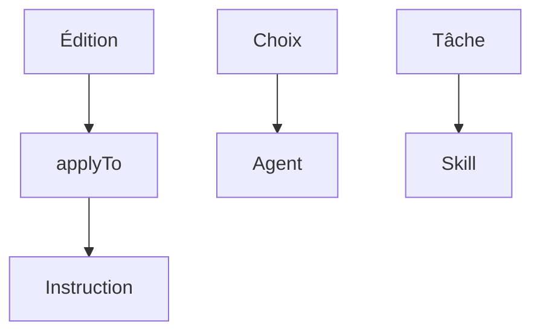

# Module 6 — Instructions, agents, skills

Une configuration est un prompt. Il entre dans la requête à un moment précis.

- Les instructions ne partent pas à chaque requête.
- Elles partent quand une édition part.
- Seulement si le fichier touché correspond au `applyTo`.

> [!note] Définition — applyTo
> Motif de chemin.
> Fichier `*.instructions.md`.
> L'instruction part si le fichier correspond.

- Un agent configuré part au moment du choix.
- Il porte le rôle et la liste des outils.
- Il ne part pas avant ce choix.
- Un skill part si la tâche correspond à sa description.
- L'instruction est payée en tokens sur cette édition.
- Le skill est payé seulement s'il est chargé.

| Configuration | Fichier |
| ------------- | ------- |
| Instruction | `.github/instructions/` `*.instructions.md` |
| Agent | `.github/agents/` `*.agent.md` |
| Skill | `.github/skills/<nom>/` `SKILL.md` |

## Documentation

| Sujet | Documentation |
| ----- | ------------- |
| Instructions | [Custom instructions](https://code.visualstudio.com/docs/copilot/customization/custom-instructions) |
| Skills | [Create agent skills](https://docs.github.com/en/copilot/how-tos/use-copilot-agents/coding-agent/create-skills) |
| Personnalisation | [Response customization](https://docs.github.com/en/copilot/concepts/prompting/response-customization) |
